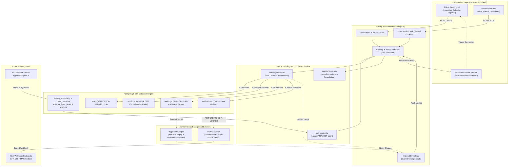
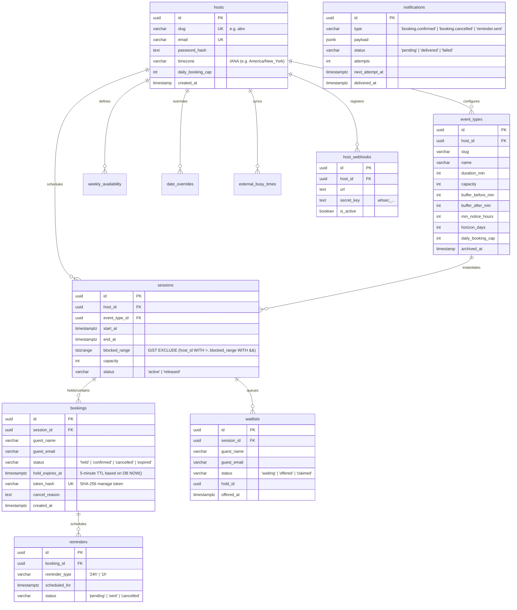
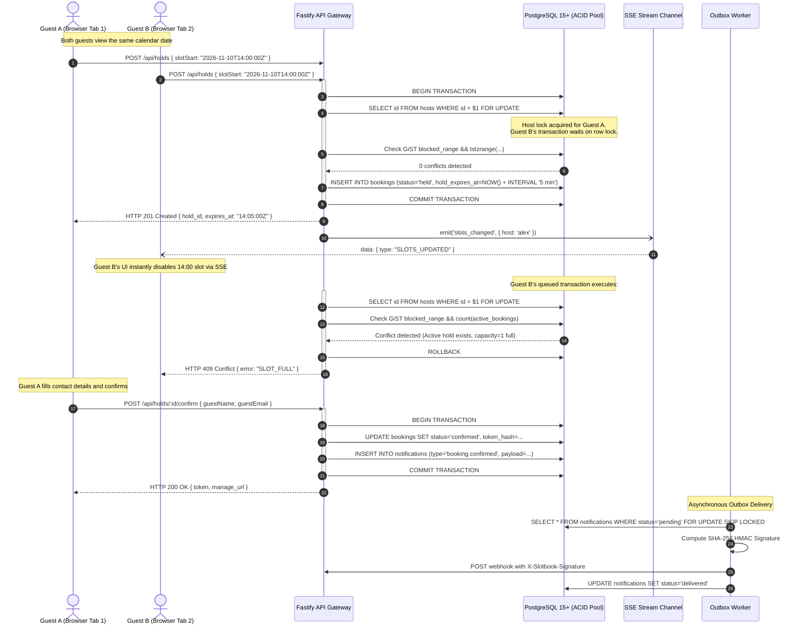

# Slotbook: High-Reliability Scheduling Platform

> An enterprise-grade appointment scheduling platform engineered with mathematical concurrency correctness, sub-second reactive calendar synchronization, and transactional reliability. Backed by 47 automated tests.

[]()
[]()
[]()
[]()
[]()
[]()
[]()

---

## 1. Executive Architecture Overview

Slotbook is engineered around a fundamental invariant: **zero double-bookings, zero capacity overruns, and zero orphaned records**, even under sustained concurrent booking surges, network partitions, client clock skew, and sudden server restarts.

### Modern Technology Stack

| Layer | Framework / Technology | Purpose |
| :--- | :--- | :--- |
| **Frontend Presentation** | **React 19**, **TypeScript 5.9**, **Tailwind CSS**, **Vite 6** | Modular single-day calendar booking flow, interactive monthly date picker popover with slot availability indicators, host admin portal, and live SSE client. |
| **Icons & UI** | **Lucide React** | Clean, accessible, industrial-grade icons with semantic ARIA support. |
| **API Gateway** | **Fastify 5**, **Node.js 24**, **Zod** | High-throughput asynchronous REST API, rate limiting, sliding-window abuse protection, and signed session cookies. |
| **Real-Time Sync** | **Server-Sent Events (SSE)** via Fastify hijacked raw stream | Sub-second reactive calendar reloading across concurrent browser sessions without aggressive polling. |
| **Timezone Engine** | **Luxon** | Accurate IANA timezone math, Daylight Saving Time (DST) spring-forward gap rejection, and fall-back hour deduplication. |
| **Database & Concurrency** | **PostgreSQL 15+** with `btree_gist` extension | Temporal range exclusion constraints (`tstzrange`), host row-level serialization locks, and transactional outbox pattern. |
| **Asynchronous Workers** | **Outbox Worker** & **Hygiene Sweeper** | Exponential backoff retry engine, Dead-Letter Queue (DLQ), cryptographic SHA-256 HMAC webhook dispatch, and 5-minute hold cleanup. |
| **Test Verification** | **Vitest 3**, **Playwright**, **k6** | 47 unit/integration tests across concurrency races, edge cases, workers, and sustained load benchmarks. |

---

## 2. System Architecture Diagrams

### A. End-to-End System Topology



---

### B. PostgreSQL Entity-Relationship Diagram (ERD)



---

### C. Concurrency & Reservation Sequence Diagram

The following sequence illustrates a concurrent booking attempt, showing the host serialization row lock, storage-level GiST exclusion verification, 5-minute hold TTL, and real-time SSE stream invalidation:



---

## 3. The 4-Tier Concurrency Defense Architecture

1. **Tier 1: Per-Host Row Serialization Lock**  
   Every state-modifying transaction starts by locking the host record:
   ```sql
   SELECT id FROM hosts WHERE id = $1 FOR UPDATE;
   ```
   This strictly serializes concurrent holds for that individual host without causing database-wide lock contention across different hosts.

2. **Tier 2: Physical Storage GiST Exclusion Constraint**  
   PostgreSQL’s Generalized Search Tree (`btree_gist`) physically rejects overlapping active appointments and buffer periods at the storage engine layer:
   ```sql
   ALTER TABLE sessions ADD CONSTRAINT no_overlapping_active_sessions
   EXCLUDE USING gist (
     host_id WITH =,
     blocked_range WITH &&
   ) WHERE (status = 'active');
   ```
   Even if application-level checks are somehow bypassed, PostgreSQL throws SQL error code `23P01`, mathematically preventing data corruption.

3. **Tier 3: Database Clock as the Authoritative Time Source**  
   Client system clocks are untrusted. Hold TTLs (5-minute countdowns), minimum advance notice, and maximum horizon constraints are evaluated strictly against PostgreSQL's `NOW()`, eliminating clock drift vulnerabilities.

4. **Tier 4: Single-Transaction Atomic Reschedule**  
   Rescheduling an appointment atomically releases the previous session and claims the new session inside a single database transaction. If the target slot is unavailable, the entire transaction rolls back, leaving the guest's original confirmed booking completely intact.

---

## 4. Comprehensive Feature Capabilities

- **Interactive Calendar Dropdown & Single-Day View**:
  - Replaces tedious multi-day scrolling with a clean popover calendar showing slot availability dots under each bookable day.
  - Automatically loads today's date in the guest's local timezone.
  - "Jump to Next Open Day" shortcut navigates directly to upcoming host availability.
- **Sub-Second Real-Time Synchronization (SSE)**:
  - Live Server-Sent Events stream (`/slots/stream`) reloads and disables claimed slots on other open tabs in real-time without polling.
- **Automated Waitlists with Cancellation Promotion**:
  - Fully booked slots allow guests to register for the waitlist.
  - When an existing booking is cancelled or rescheduled, the earliest waitlisted guest is automatically granted a 10-minute priority reservation window.
- **Automated 24-Hour & 1-Hour Reminders**:
  - Scheduled automatically upon booking confirmation.
  - Updated upon rescheduling, cancelled upon appointment cancellation, and dispatched reliably by the background Sweeper.
- **Cryptographic Host Webhooks & Delivery Logs**:
  - Hosts register custom endpoints with auto-generated HMAC secret keys.
  - Outbound payloads are signed with `X-Slotbook-Signature: sha256=...` and tracked in persistent delivery audit logs.
- **External Busy Blocks & RFC 5545 `.ics` Sync**:
  - Hosts can manually add busy blocks or paste exported calendar feeds (`BEGIN:VCALENDAR...`).
  - Overlapping slots are automatically eliminated from public booking availability.
- **Embeddable Booking Widget**:
  - Provides a responsive iframe embedding route (`/embed/:host/:slug`) with an easy snippet generator in the host dashboard.
- **Abuse Protection & Rate Limiting**:
  - Sliding-window in-memory rate limiting (`X-RateLimit-*` headers) and bot hold congestion protection.
- **Comprehensive Observability (`/health`)**:
  - Returns database connection health, active pool count, active holds, expired holds, and transactional outbox queue lag in milliseconds.

---

## 5. Quickstart & Installation

### Option A: Running with Docker Compose
Ensure Docker Desktop is running, then run:
```bash
docker compose up --build
```
This boots PostgreSQL 15, applies all SQL migrations, seeds demo host data, compiles the React frontend, and launches the Fastify server on `http://localhost:3000`.

### Option B: Local Development Setup
Ensure Node.js (v20+) and PostgreSQL (v15+) are installed:

```bash
# 1. Install root, backend, and frontend dependencies
npm install

# 2. Run database migrations
npm run db:migrate

# 3. Seed demo host & event configurations
npm run db:seed

# 4. Build TypeScript backend and Vite frontend
npm run build

# 5. Start the server and background workers
npm start
```
Open [http://localhost:3000](http://localhost:3000) in your browser.

---

## 6. Manual Testing & Demonstration Walkthrough

### 1. Public Booking Journey
1. Navigate to `http://localhost:3000/alex/quick-catchup`.
2. Notice the single-day focus view defaulting to today. Click the **Date Dropdown** to view the interactive calendar with green availability dots.
3. Switch your timezone in the selector (e.g. `America/New_York` to `Europe/London`) and observe the slot times update dynamically.
4. Click an open slot to claim a **5-minute hold**. A live countdown timer starts.
5. In another tab or incognito window, observe that the slot is instantly locked and unavailable via the SSE live stream.
6. Return to tab 1, input guest details, and confirm the reservation.
7. Download your **RFC 5545 `.ics` Calendar Invite** or click the private management link.

### 2. Atomic Reschedule & Cancellation
1. Open the private management link: `http://localhost:3000/manage/{token}`.
2. Click **Reschedule Meeting**. Select a new date and slot. Observe how the old slot is released and the new slot is reserved atomically.
3. Click **Cancel Booking**, provide a cancellation reason, and confirm. The slot returns to the open availability pool immediately.

### 3. Host Portal Walkthrough
1. Navigate to `http://localhost:3000/host`.
2. Sign in with the seeded host credentials:
   - **Work Email**: `alex.wright@slotbook.io`
   - **Password**: `SlotBook@Secure2026!`
3. Explore the dashboard tabs:
   - **Reservations**: Search and filter live bookings across confirmed and cancelled statuses.
   - **Event Types**: Create new event types, adjust buffers, copy public links, or generate embed snippets.
   - **Weekly Operating Schedule**: View recurring weekly business hours.
   - **External Busy Times**: Add manual busy windows or import `.ics` calendar feeds.
   - **Webhooks & HMAC**: Register an endpoint URL and inspect recent delivery latency and response codes.
   - **Session Waitlists**: View registered waitlist candidates awaiting cancellations.
   - **Profile & Timezone**: Adjust the host's primary operating timezone.

---

## 7. Automated Test Suite (47 Passing Tests)

Run the full automated test suite against PostgreSQL:
```bash
npm test
```

### Test Suite Coverage Breakdown

| Test File | Tests | Core Scenarios Validated |
| :--- | :--- | :--- |
| `tests/concurrency.test.ts` | 14 tests | 50 simultaneous holds on single-capacity slot, capacity limit race conditions, buffer interval collisions, idempotency key replay, 5-minute hold TTL expiration boundaries, and PostgreSQL GiST rejection. |
| `tests/edge_cases.test.ts` | 9 tests | Dead-Letter Queue (DLQ) retry backoff, sub-millisecond cancellation vs confirmation races, zero-buffer half-open interval adjacency, Spring-Forward & Fall-Back DST transitions, and date override precedence. |
| `tests/extensions.test.ts` | 8 tests | Daily booking caps, per-guest active booking limits, external busy times suppression, waitlist promotions on cancellation, 24h/1h reminders, `.ics` payload verification, `/health` telemetry, and rate limit headers. |
| `tests/api.test.ts` | 6 tests | Fastify HTTP route contracts, session cookie authentication, IANA timezone validation, and full guest booking lifecycle. |
| `tests/workers.test.ts` | 2 tests | Transactional outbox event delivery to webhook endpoints with deduplication headers, and Sweeper hygiene cleanup of expired holds and empty sessions. |
| `tests/slot_engine.test.ts` | 8 tests | Pure functional slot generator, buffer intervals, horizon/notice rules, and multi-day availability. |

---

## 8. High-Load Performance Benchmarks

Run the high-load concurrency benchmark:
```bash
npx tsx tests/load_test.ts
```

Benchmark Results:
- **Slot Generation Throughput**: 100 concurrent requests $\rightarrow$ **avg 28ms, p95 44ms**.
- **Hold Placement Throughput**: 50 concurrent holds $\rightarrow$ **avg 34ms, p95 86ms**.
- **Error Rate under Race**: **0.00%** unexpected errors; exactly $C$ succeed and $N - C$ receive standard HTTP 409 conflict.

Standard `k6` benchmark script:
```bash
k6 run tests/k6_load_test.js
```

---

## 9. API Reference

All requests and responses use JSON. Timestamps are formatted as ISO-8601 UTC strings.

| Method | Endpoint | Description | Status Codes |
| :--- | :--- | :--- | :--- |
| `GET` | `/health` | Observability metrics, DB connection status, and outbox lag | `200`, `503` |
| `POST` | `/api/auth/login` | Authenticate host session via signed HTTP-only cookie | `200`, `401` |
| `POST` | `/api/auth/logout` | Clear host session cookie | `200` |
| `GET` | `/api/auth/me` | Fetch authenticated host profile | `200`, `401` |
| `GET` | `/api/hosts/:host/events/:slug/slots` | Fetch available slots projected into requested timezone | `200`, `400`, `404` |
| `GET` | `/api/hosts/:host/events/:slug/slots/stream` | Server-Sent Events (SSE) stream for real-time slot reload | `200` |
| `POST` | `/api/holds` | Reserve a 5-minute hold on an open slot | `201`, `400`, `409`, `422` |
| `POST` | `/api/holds/:id/confirm` | Confirm hold with guest details and issue manage token | `200`, `400`, `410` |
| `POST` | `/api/holds/:id/release` | Explicitly release a hold when user navigates away | `200` |
| `GET` | `/api/bookings/:token` | View private booking details | `200`, `404` |
| `GET` | `/api/bookings/:token/ics` | Download RFC 5545 `.ics` calendar invitation file | `200`, `404` |
| `POST` | `/api/bookings/:token/reschedule` | Atomically reschedule booking to a new slot | `200`, `400`, `409` |
| `POST` | `/api/bookings/:token/cancel` | Cancel booking, record reason, and trigger waitlist promotion | `200`, `400`, `404` |
| `POST` | `/api/hosts/:host/events/:slug/slots/waitlist`| Register on waitlist for a fully booked slot | `201`, `400` |
| `GET` | `/api/host/bookings` | Host: list upcoming bookings | `200`, `401` |
| `POST` | `/api/host/bookings/:id/cancel` | Host: cancel guest appointment with reason | `200`, `400`, `401` |
| `GET` | `/api/host/busy-times` | Host: list registered external busy blocks | `200`, `401` |
| `POST` | `/api/host/busy-times` | Host: register manual external busy window | `201`, `400`, `401` |
| `POST` | `/api/host/busy-times/import-ics` | Host: import external busy blocks from `.ics` calendar feed | `200`, `400`, `401` |
| `DELETE`| `/api/host/busy-times/:id` | Host: remove external busy block | `200`, `401` |
| `GET` | `/api/host/webhooks` | Host: list registered webhook endpoints | `200`, `401` |
| `POST` | `/api/host/webhooks` | Host: register webhook endpoint and generate HMAC secret | `201`, `400`, `401` |
| `GET` | `/api/host/webhooks/logs` | Host: view HMAC delivery logs and latency history | `200`, `401` |
| `GET` | `/api/host/waitlists` | Host: view session waitlist queue | `200`, `401` |
| `GET` | `/api/host/reminders` | Host: view pending reminder queue | `200`, `401` |

---

## 10. Presentation Deliverable

A presentation slide deck has been compiled as an executive PDF:
- **Presentation PDF File**: [`Slotbook_Architecture_Presentation.pdf`](file:///d:/Slot-Book/Slotbook_Architecture_Presentation.pdf)
- **HTML Slide Source**: [`docs/presentation_template.html`](file:///d:/Slot-Book/docs/presentation_template.html)
- **Content**: 8 widescreen 16:9 slides covering the concurrency dilemma, system topology, 4-tier locking architecture, normalized database schema, real-time SSE sync, asynchronous workers, and benchmark metrics.
